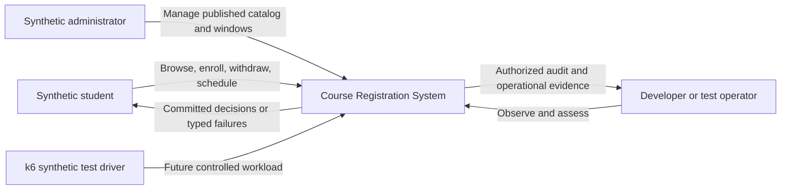
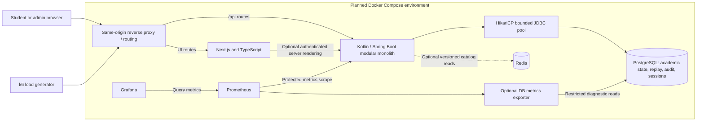
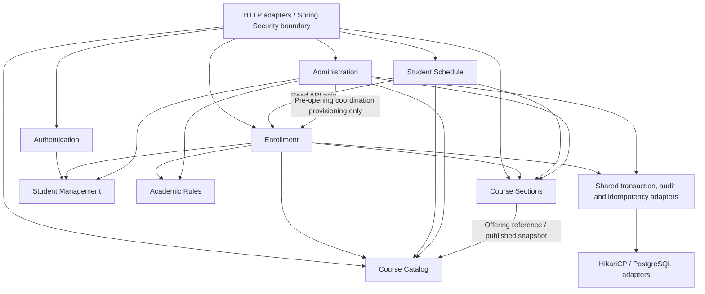
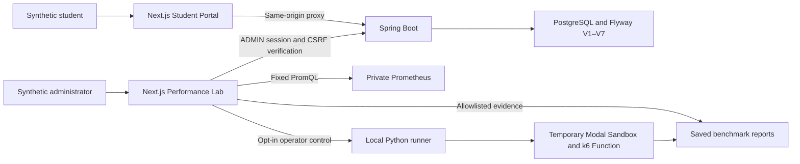
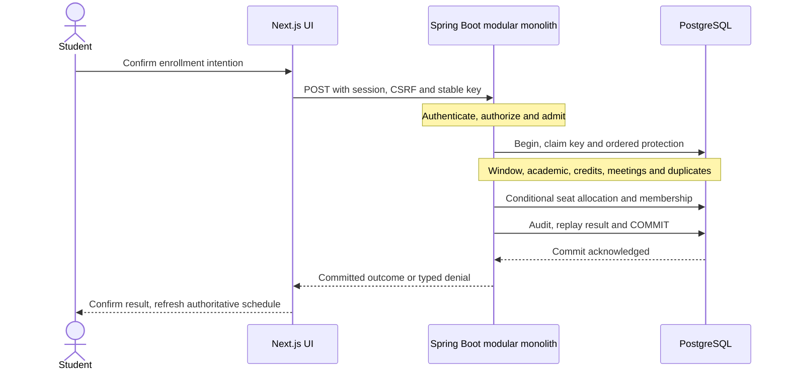

# Detailed system architecture

Status: Phase 2 architecture baseline reconciled with Phase 5 implementation, November 6, 2026. Authentication, public module ports, Enrollment/Withdrawal, coherent schedule reads and AD-13 are implemented and tested. Existing identifiers remain intact; [Phase 5 verification](phase5-verification.md) defines the executed boundary.

## Design baseline and document ownership

The baseline remains **Next.js → Kotlin/Spring Boot modular monolith → PostgreSQL**. Redis is optional; HikariCP bounds JDBC connections; Prometheus/Grafana provide planned monitoring; k6 is the future test generator; Docker Compose supplies the local PostgreSQL runtime. The implementation remains a modular monolith; no microservices, Kubernetes, broker or paid API is introduced.

One local transaction is appropriate because enrollment combines section allocation with student-wide credits, meetings and eligibility. Module interfaces give ownership without distributed commit or inter-service calls. The trade-off is shared deployment, database availability and hot-row contention; modularity is not evidence of performance. [AD-01, AD-02 and AD-11](architecture-decisions.md) record alternatives and consequences.

| Document | Canonical responsibility |
| --- | --- |
| [Requirements](requirements.md) | FR/NFR/BR rules, CT acceptance scenarios and Q open policy questions |
| This document | Context/containers/components, module interfaces, dependency graph and architecture review findings |
| [Enrollment design](enrollment-design.md) | Ordered writer protocol, transaction/idempotency lifecycle, success/full/replay sequences and crash behavior |
| [Scaling strategy](scaling-strategy.md) | Resource/admission budgets, replica evolution, graceful degradation and FS failure matrix |
| [Architecture decisions](architecture-decisions.md) | AD-01 through AD-13 rationale, alternatives and trade-offs |
| [Database](database.md), [Database concurrency](database-concurrency.md), [Data integrity](data-integrity.md) | Phase 3 table/index/ERD proposal, exact lock/FK/expiry protocol, privileges and future verification |
| [API specification](api-specification.md), [Security](security.md), [Performance](performance.md) | HTTP outcomes, synthetic identity/security boundary, and unverified numerical targets respectively |

## System context diagram



Students and administrators are test actors in the MVP. Real SDU accounts, production transcript systems and university SSO are outside this boundary. This design makes no findings about the existing university portal. The operator controls a future local environment and synthetic dataset, not SDU production.

## Container architecture diagram



The proxy provides routing and finite admission, not academic decisions. Next.js renders flows and preserves the mutation intention/key; server rendering never writes PostgreSQL directly. Spring Boot authenticates requests, evaluates rules, owns transactions and returns committed outcomes. HikariCP reuses a bounded connection set; it does not allocate one connection per student. PostgreSQL owns confirmed state and the chosen shared session store. Optional Redis can cache immutable published catalog metadata but never decides seats or eligibility.

Prometheus/Grafana are operational tools; business audit is transactional database state. A database exporter is optional instrumentation, not an enrollment dependency. k6 measures only the declared request path and synthetic fixtures; it is not part of serving student requests. Phase 4 configures/runs PostgreSQL only; monitoring, Redis and frontend containers remain future work.

## Backend component diagram

Arrows between domain modules mean permitted calls to public APIs, not access to internal repositories. All are inside one deployable.



Persistence adapters for all owning modules use the same planned datasource and transaction manager; their individual technical connections are omitted. Academic Rules receives immutable fact values for evaluation and never calls Student Schedule. Enrollment never calls Student Schedule or Administration, preventing a write/read dependency cycle.

## Student and operator interfaces

The Next.js Student Portal uses an allowlisted same-origin proxy to Spring. It passes opaque sessions, CSRF and idempotency headers, then refreshes the authoritative seat snapshot and schedule. A small read-only Student Portal projection joins the published catalog, policy gate and caller’s student-term assignment. The projection holds no state and has no write privileges of its own. Enrollment, withdrawal and academic evaluation continue through the existing module boundaries.

Performance Lab combines read-only Phase 6 evidence, local experiments and projected Modal reports. A separate ADMIN-only server route resolves fixed Prometheus queries against the private monitoring stack. Optional Modal commands require the same Spring ADMIN and CSRF checks, explicit confirmation, a private Next.js operator process and the bounded CLI runner.



[Local demo](demo.md) · [HTTP contract](api-specification.md) · [Database ERD](database-erd.md)

## Modules and ownership

Public interface names below are conceptual contracts, not Kotlin declarations. Every listed write is authenticated/authorized at the boundary and audited where it changes business data.

### Authentication

- **Responsibility:** establish a trusted synthetic student/admin principal, manage login/logout and session lifecycle, and enforce the HTTP security boundary.
- **Public interfaces:** `AuthenticateTestAccount`, `ResolvePrincipal`, `LogoutSession`, and trusted principal/role values for inbound use cases.
- **Dependencies:** Student Management public identity lookup at account provisioning/login; shared security/session infrastructure. No Enrollment dependency.
- **Data ownership:** synthetic account-to-student mapping, test credential verifier, roles, opaque sessions and revocation metadata. Student academic profile/transcripts belong to Student Management.
- **Business rules:** FR-01, BR-08, SEC-01/SEC-02; no principal or admin role accepted from arbitrary request headers/body. No real university credential capture.
- **Transaction boundaries:** short account/session operations outside enrollment. Session persistence must not hold an authentication transaction open while waiting for domain locks. Already admitted transactions are not retroactively cancelled by logout; future authentication/replay checks honor revocation.

### Student Management

- **Responsibility:** synthetic student profiles, academic status/cohort, local eligibility records and snapshot freshness.
- **Public interfaces:** `StudentIdentityQuery`, `StudentEligibilitySnapshotQuery`, and a guarded `SyntheticStudentProvisioning` command for the test environment.
- **Dependencies:** shared types/persistence only; no calls into Enrollment or Authentication internals.
- **Data ownership:** academic student identity/profile, cohort facts and versioned synthetic transcript/equivalency evidence. Enrollment owns the student-term coordination resource.
- **Business rules:** FR-10, BR-05/BR-10; missing eligibility fails explicitly. In-use eligibility snapshots remain immutable; no transcript network call in a write transaction.
- **Transaction boundaries:** reads join the caller's snapshot; provisioning/import writes run in the guarded pre-opening administration lifecycle. Live mutation of referenced eligibility is outside the baseline.

### Course Catalog

- **Responsibility:** terms, courses, term offerings, publication lifecycle and immutable credit/prerequisite definitions.
- **Public interfaces:** `PublishedCatalogQuery`, `OfferingSnapshotQuery`, and guarded `CatalogDraftCommand` / `PublishOffering` ports.
- **Dependencies:** shared types/persistence only. Publication receives validated facts or is orchestrated by Administration; Catalog never calls Enrollment or Course Sections internals.
- **Data ownership:** term/course/offering identities and published versions, credits and prerequisite definitions. Sections own capacity and meeting occurrences.
- **Business rules:** FR-02/FR-11, BR-05/BR-10; students see only published data. Versions referenced by active enrollment cannot be edited in place.
- **Transaction boundaries:** bounded catalog reads; commands join an Administration root transaction under the term-policy gate. No foreign repository writes or independent commit during publication.

### Course Sections

- **Responsibility:** section publication facts, required meetings, capacity, occupancy and seat mutation.
- **Public interfaces:** `PublishedSectionQuery`, `SectionSnapshotQuery`, transactional `LockSection`, `TryAllocateSeat`, `ReleaseSeat`, and guarded `SectionDraftCommand` / `ChangeCapacity`.
- **Dependencies:** Course Catalog public offering-reference/snapshot API and shared types/persistence. No Enrollment callback.
- **Data ownership:** section identity/offering relation, immutable published meetings and mutable capacity/occupancy. Does not own student membership rows.
- **Business rules:** FR-03/FR-07/FR-11, BR-01/BR-10; allocation is conditional, release never decrements twice, capacity cannot drop below occupied count. Meeting edits cannot reinterpret active enrollment.
- **Transaction boundaries:** reads join the caller's read snapshot. Seat ports require an existing Enrollment root transaction with gate/student protection; capacity edits require an Administration root with gate/section protection. Ports cannot independently commit.

### Enrollment

- **Responsibility:** enrollment/withdrawal orchestration, authoritative membership, student-term synchronization, replay and transactional audit.
- **Public interfaces:** `EnrollStudent`, `WithdrawEnrollment`, ownership-scoped `ActiveEnrollmentQuery` / `EnrollmentHistoryQuery`, and guarded pre-opening `PrepareStudentTerm`. Public query results contain version references for schedule composition.
- **Dependencies:** Student Management, Course Catalog, Course Sections and Academic Rules public APIs; shared transaction/audit adapters. Never Student Schedule.
- **Data ownership:** stable student-term coordination, active/historical enrollment state, optional maintained credit total, scoped idempotency outcomes. Section occupancy is mutated only through Course Sections.
- **Business rules:** FR-04/FR-05/FR-08/FR-09/FR-10, BR-01 through BR-09 and BR-11/BR-12; no success before commit, no second active membership.
- **Transaction boundaries:** one root READ COMMITTED transaction per enrollment/withdrawal, with the ordered protocol and joined owning-module ports. A retry starts a new root transaction. Replays avoid domain locks. `PrepareStudentTerm` instead joins authorized pre-opening Administration setup under exclusive term-gate protection; it cannot allocate seats or run as an insert-on-miss shortcut. See the canonical [Enrollment design](enrollment-design.md).

### Academic Rules

- **Responsibility:** authoritative window/cohort/credit-policy selection and deterministic prerequisite, credit and meeting-conflict evaluation.
- **Public interfaces:** transactional `ProtectTermPolicy`, immutable `EffectivePolicyQuery`, pure `EvaluateEnrollmentRules`, and guarded `ConfigureWindows` / `CloseRegistration` commands.
- **Dependencies:** shared fact/identifier types and its own persistence; receives immutable student/catalog/meeting facts from the orchestrator rather than querying other modules itself.
- **Data ownership:** stable term-policy gate, enrollment/withdrawal windows and versions, effective credit/cohort policies. Course-specific prerequisite definitions remain Catalog-owned; student evidence remains Student-owned.
- **Business rules:** FR-08 through FR-10, FR-12, BR-03/BR-04/BR-05/BR-08/BR-10/BR-11; real wall-clock decision after lock waits, half-open windows and no silent missing-evidence pass.
- **Transaction boundaries:** pure evaluation has no transaction/side effects; protected policy reads join Enrollment. Configuration/close participates in an Administration root transaction with exclusive term protection; no lock upgrade from a shared gate.

### Student Schedule

- **Responsibility:** compose a student's current active meetings and credit summary for display; no registration writes or independent schedule ledger.
- **Public interfaces:** ownership-scoped `StudentScheduleQuery` with explicit term and academic timezone.
- **Dependencies:** Enrollment read APIs, Course Catalog and Course Sections published snapshot APIs. Enrollment never depends on this module.
- **Data ownership:** response view only; no separate persistence or cache of authoritative membership.
- **Business rules:** FR-06, BR-03/BR-04; active memberships only, every meeting included, published versions respected. A seat display is not a reservation.
- **Transaction boundaries:** one short read-only REPEATABLE READ snapshot on primary PostgreSQL for multi-query composition; all read ports join it. A single equivalent snapshot query is an implementation option behind the same boundaries. No blocking registration lock is required; a read begun after acknowledged confirmation sees that prior commit. Future commits after its snapshot need not appear.

### Administration

- **Responsibility:** authorized orchestration of draft management, validation/publication, safe capacity edits, synthetic-data setup and registration-window configuration.
- **Public interfaces:** admin HTTP/use-case commands for Catalog/Sections/Academic Rules/Student Management, with explicit version preconditions and command deduplication contracts.
- **Dependencies:** those four owning-module public APIs, Enrollment's `PrepareStudentTerm` provisioning API only, and shared audit/transaction infrastructure. No access to Enrollment repositories, student enrollment/withdrawal commands, or forced-registration bypass.
- **Data ownership:** no duplicate domain tables or independent academic truth; command deduplication metadata may be owned here once specified in Phase 3.
- **Business rules:** FR-11/FR-12, BR-01/BR-08/BR-10/BR-11 and SEC-02/SEC-06; admin privilege never bypasses capacity/immutability. No multi-student override/import after opening without a reviewed protocol.
- **Transaction boundaries:** one root transaction for an approved atomic admin command, with owned module ports joining. Window close uses the exclusive term gate; capacity edits use shared gate then exclusive section. Batch/long-running import and global repair are not hidden enrollment transactions.

## Allowed dependencies and data exchange

| Caller | Allowed domain API dependencies |
| --- | --- |
| Authentication | Student Management identity lookup |
| Student Management | None |
| Course Catalog | None |
| Course Sections | Course Catalog; Authentication current-actor check for protected reads |
| Academic Rules | None; evaluates supplied immutable facts |
| Enrollment | Authentication current-actor boundary, Student Management, Course Catalog, Course Sections, Academic Rules |
| Student Schedule | Enrollment read APIs, Course Catalog, Course Sections |
| Administration | Student Management, Course Catalog, Course Sections, Academic Rules; Enrollment pre-opening provisioning API only |

Only public `api` contracts may cross a module boundary: immutable value/snapshot DTOs, bounded query results, typed decisions and command outcomes. Do not return persistence entities, repositories, lazy ORM collections or internal services. Technical adapters use their owning module's internal ports. Cross-module database joins, if later needed for a query optimization, must be encapsulated behind an explicitly reviewed query API rather than arbitrary foreign table/repository access.

Permissions apply per port, not merely per module edge: Schedule can call Enrollment queries only; Administration can call Enrollment provisioning only; only Enrollment can call section allocation/release ports. Administration uses section draft/capacity ports instead. Provisioning is orchestrated through the owning APIs, so Student Management never inserts Enrollment coordination data directly.

Synchronous in-process calls suffice. Business audit joins the root transaction; metrics/logging are diagnostic. No event bus, distributed transaction, async schedule projection or outbox is needed for current requirements. Future notifications would need a separate reliable post-commit design. Phase 4 adds an initial source-import boundary test for production code. Public business ports now have immutable DTOs and implementation adapters. Database adapters that participate in domain work require MANDATORY propagation; import boundary tests and review enforce module access.

## Proposed Kotlin package structure

The package layout below is implemented. Administration management APIs remain future work. `org.example` is a placeholder namespace, not a claimed university domain.

```text
org.example.sdu.registration
├── authentication/{api,internal/{application,domain,persistence,web}}
├── students/{api,internal/{application,domain,persistence}}
├── catalog/{api,internal/{application,domain,persistence,web}}
├── sections/{api,internal/{application,domain,persistence,web}}
├── enrollment/{api,internal/{application,domain,persistence,web}}
├── academicrules/{api,internal/{application,domain,persistence}}
├── schedule/{api,internal/{application,query,web}}
├── administration/{api,internal/{application,persistence,web}}
├── shared/{identifiers,errors,audit,idempotency,observability,transactions}
└── bootstrap
```

Keep shared identifiers/errors/technical adapters small; shared must not become a competing domain module. `bootstrap` wires modules and adapters. Kotlin visibility alone is not assumed to enforce package privacy inside one build; later static dependency tests/review must prohibit `.internal` imports across modules. Whether to split build subprojects is deferred until an engineering benefit exists.

## Course enrollment sequence overview

This container-level sequence shows the browser boundary; the [detailed success sequence](enrollment-design.md#successful-registration-sequence), [no-seats sequence](enrollment-design.md#no-seats-sequence) and [same-key replay sequence](enrollment-design.md#concurrent-identical-requests-and-replay-sequence) own transaction details.



The overview omits alternative branches; only the detailed sequence covers denial/replay behavior. No UI confirmation is inferred from a request receipt or stale availability.

## Consistency, scaling, and operational boundaries

[Enrollment design](enrollment-design.md) is authoritative for ACID, READ COMMITTED writes, student/section synchronization, constraints, rollback and crash points. [AD-12](architecture-decisions.md#ad-12--separate-authoritative-schedule-reads-from-enrollment-validation) defines snapshot-consistent schedule reads. The Phase 3 [physical dictionary](database.md) and [lock/FK analysis](database-concurrency.md) now specify these interactions; execution and failure/concurrency verification are still pending.

Begin with a bounded single-instance baseline. [Scaling strategy](scaling-strategy.md) defines reverse-proxy admission, aggregate HikariCP budgeting, optional cache fallback and measured replica rollout, plus FS-01 through FS-12 failure verification. Cross-instance correctness uses PostgreSQL, not sticky sessions or local mutexes. Prometheus/Grafana must expose queue/pool/lock/outcome pressure without sensitive labels.

## Design review findings

These preserved Phase 2 findings distinguish prior ambiguities, newly specified requirements and unresolved risks. Phase 3 resolutions/remaining risks are recorded separately as [DBF-01 through DBF-12](data-integrity.md#phase-3-findings-and-architecture-risks). They do not assert production defects or measured system limits.

| ID | Finding | Resolution / remaining risk |
| --- | --- | --- |
| AF-01 | Phase 1's roadmap named Phase 2 Database Design, while the current instruction defines Detailed System Design now. | Align the roadmap: Phase 2 detailed architecture, Phase 3 Database Design; do not begin Phase 3. Requirement/decision IDs stay stable. |
| AF-02 | Earlier module groups combined identity/academic records, sections/catalog and enrollment/schedule. | Refine into the eight requested modules with mapped ownership. Maintain the original transactional decisions and avoid a Schedule ↔ Enrollment cycle. |
| AF-03 | Authentication was unresolved and described future university SSO, while the MVP now requires only synthetic actors. | Select test authentication and shared opaque sessions; production identity remains Q-01. No real university account dependency. |
| AF-04 | Phase 1 mentioned section row locks and atomic updates without clearly comparing their overlap. | Select both explicitly: ordered pessimistic coordination plus conditional capacity guard. Hot-row serialization and additional round trip need measurement. |
| AF-05 | Storing a stable replay body before commit while calling its timestamp the exact committed timestamp was ambiguous. | Use protected decision time `decidedAt` and emit success after commit; do not require database commit-timestamp tracking. |
| AF-06 | A displayed schedule assembled through several independent reads could mix committed states. | Use one short read snapshot across public query ports on primary PostgreSQL; no duplicate authoritative schedule store. |
| AF-07 | Window-row selection, missing coordination rows and separate enrollment/withdrawal windows left coordination details open. | Pre-provision one stable term-policy gate and student-term resources. Shared gate pins all applicable policy selection; exclusive configuration prevents window phantoms. Physical representation remains Phase 3. |
| AF-08 | Deadlock freedom, uniqueness keys, foreign-key lock interactions and idempotency cleanup races cannot be established from conceptual entities alone. | Define ordered writers and no independent IN_PROGRESS lease; require Phase 3 physical lock/constraint review and later failure tests. Q-11/Q-13 remain partly open. |
| AF-09 | Closing a window alone does not protect existing students from later changes to referenced meetings/credits. | Keep referenced published academic versions immutable; live corrections need an additional product/revalidation workflow under Q-08. |
| AF-10 | A safe 30-seat allocation does not demonstrate a 5,000-active-user workload or bounded hot-burst latency. | Keep PERF targets unverified, separate healthy complete-allocation tests from overload/burst tests, and measure successful outcomes as well as rejections. |
| AF-11 | Replicas with local sessions/rate counters could break continuity or multiply admitted load. | Select PostgreSQL-backed sessions and aggregate connection/admission budgeting before replicas; exact global quota mechanism remains conditional on need. |
| AF-12 | Two linked application repos and a separate local design workspace have no assigned shared-document/contract authority. | Preserve historical inspection evidence; keep Q-12 open and do not configure remotes, copy source or push documentation implicitly. |

## Open questions and next design gate

Q-02 through Q-08 still require academic policy decisions: credit units/overrides, linked course components, time/recurrence semantics, prerequisite evidence/waivers, cohort windows, fairness and live corrections. Q-09/Q-10/Q-11 require workload, recovery and replay retention/budget decisions; Q-12/Q-13 require repository and provisioning ownership. The MVP half of Q-01 is decided; real identity remains future scope.

Phase 3 provides a [physical model](database.md), [ERD](database-erd.md), [writer/expiry protocol](database-concurrency.md) and [integrity/fixture review plan](data-integrity.md). Its shared technical operations table avoids duplicate student/admin claim logic while operation semantics stay with their owning module. The standard two-table Spring Session layout avoids a custom incompatible session schema. Phase 4 verifies the physical foundation and proposes late section acquisition in AD-13. Review model-changing academic questions before separately authorizing Phase 5; full enrollment correctness and performance capacity have not been demonstrated.
