# Database ER diagram

Status: Phase 3 Mermaid view retained for the Phase 4 implemented physical model. The [physical dictionary](database.md#physical-table-specifications) defines complete constraints, nullability, ownership and index semantics; this diagram does not replace it. Flyway schema creation and actual FK/column comparison were executed in Phase 4; see [verification](phase4-verification.md).

Entity names below correspond to schema-qualified tables in the dictionary (for example STUDENT_TERMS is `enrollment.student_terms`). PK/FK markings apply to components of composite keys; they do not mean each marked column is independently unique. Only actual FK relationships are drawn. In particular framework session principal_name, polymorphic audit targets and idempotency domain targets are intentionally not FK relationships.

```mermaid
erDiagram
    STUDENTS {
        uuid student_id PK
        text student_number UK
        text display_name
        timestamptz created_at
    }
    TEST_ACCOUNTS {
        uuid principal_id PK
        uuid student_id FK, UK
        text login_name UK
        text password_hash
        text role
        boolean enabled
        bigint auth_version
        timestamptz created_at
    }
    ACADEMIC_TERMS {
        uuid term_id PK
        text code UK
        date starts_on
        date ends_on
        text timezone_name
    }
    TERM_POLICY_GATES {
        uuid term_id PK, FK
        text configuration_state
        bigint revision
        timestamptz updated_at
    }
    REGISTRATION_POLICIES {
        uuid policy_id PK
        uuid term_id FK
        text cohort_code
        integer policy_version
        numeric credit_limit
        timestamptz created_at
    }
    REGISTRATION_WINDOWS {
        uuid window_id PK
        uuid policy_id FK
        text operation_type
        timestamptz opens_at
        timestamptz closes_at
        boolean is_closed
        timestamptz closed_at
    }
    COURSES {
        uuid course_id PK
        text code UK
        text title
        timestamptz created_at
    }
    COURSE_OFFERINGS {
        uuid offering_id PK
        uuid term_id FK
        uuid course_id FK
        text title
        numeric credits
        text publication_status
        bigint draft_revision
        timestamptz published_at
    }
    COURSE_SECTIONS {
        uuid section_id PK
        uuid offering_id FK
        uuid term_id FK
        text section_code
        integer capacity
        integer enrolled_count
        text publication_status
        timestamptz published_at
        bigint config_version
    }
    INSTRUCTORS {
        uuid instructor_id PK
        text display_name
    }
    SECTION_INSTRUCTORS {
        uuid section_id PK, FK
        uuid instructor_id PK, FK
    }
    SECTION_MEETINGS {
        uuid meeting_id PK
        uuid section_id FK
        timestamptz starts_at
        timestamptz ends_at
        text meeting_kind
        boolean is_required
        text venue
    }
    OFFERING_PREREQUISITES {
        uuid offering_id PK, FK
        uuid required_course_id PK, FK
        numeric minimum_grade
        text grade_scheme
    }
    ELIGIBILITY_SNAPSHOTS {
        uuid snapshot_id PK
        uuid student_id FK
        text source_version
        text evidence_state
        text academic_status
        timestamptz captured_at
    }
    COMPLETED_COURSES {
        uuid snapshot_id PK, FK
        uuid course_id PK, FK
        boolean passed
        numeric grade_value
        text grade_scheme
        date completed_on
    }
    OFFERING_POLICY_ELIGIBILITY {
        uuid offering_id PK, FK
        uuid policy_id PK, FK
        uuid term_id FK
    }
    STUDENT_TERMS {
        uuid student_id PK, FK
        uuid term_id PK, FK
        uuid policy_id FK
        text cohort_code FK
        uuid eligibility_snapshot_id FK
        numeric credit_limit_override
        timestamptz created_at
    }
    ENROLLMENTS {
        uuid enrollment_id PK
        uuid student_id FK
        uuid term_id FK
        uuid policy_id FK
        uuid offering_id FK
        uuid section_id FK
        uuid enroll_window_id FK
        text status
        timestamptz enrolled_at
        timestamptz withdrawn_at
        uuid withdraw_window_id FK
    }
    IDEMPOTENCY_RECORDS {
        uuid operation_id PK
        uuid principal_id FK
        text operation_type
        smallint operation_version
        uuid idempotency_key
        bytea request_fingerprint
        text target_type
        uuid target_id
        uuid target_term_id
        text state
        timestamptz created_at
        timestamptz decided_at
        smallint response_status
        text response_code
        jsonb response_body
        timestamptz expires_at
    }
    AUDIT_EVENTS {
        uuid audit_id PK
        uuid operation_id
        uuid actor_principal_id FK
        text event_type
        text target_type
        uuid target_id
        uuid enrollment_id FK
        timestamptz decided_at
        uuid correlation_id
        jsonb details
    }
    SPRING_SESSION {
        char primary_id PK
        char session_id UK
        bigint creation_time
        bigint last_access_time
        integer max_inactive_interval
        bigint expiry_time
        varchar principal_name
    }
    SPRING_SESSION_ATTRIBUTES {
        char session_primary_id PK, FK
        varchar attribute_name PK
        bytea attribute_bytes
    }
    STUDENTS o|--o| TEST_ACCOUNTS : fk_account_student
    ACADEMIC_TERMS ||--o| TERM_POLICY_GATES : fk_gate_term
    ACADEMIC_TERMS ||--o{ REGISTRATION_POLICIES : fk_policy_term
    REGISTRATION_POLICIES ||--o{ REGISTRATION_WINDOWS : fk_window_policy
    ACADEMIC_TERMS ||--o{ COURSE_OFFERINGS : fk_offering_term
    COURSES ||--o{ COURSE_OFFERINGS : fk_offering_course
    COURSE_OFFERINGS ||--o{ COURSE_SECTIONS : fk_section_offering_term
    COURSE_SECTIONS ||--o{ SECTION_INSTRUCTORS : fk_assignment_section
    INSTRUCTORS ||--o{ SECTION_INSTRUCTORS : fk_assignment_instructor
    COURSE_SECTIONS ||--o{ SECTION_MEETINGS : fk_meeting_section
    COURSE_OFFERINGS ||--o{ OFFERING_PREREQUISITES : fk_prerequisite_offering
    COURSES ||--o{ OFFERING_PREREQUISITES : fk_prerequisite_course
    STUDENTS ||--o{ ELIGIBILITY_SNAPSHOTS : fk_snapshot_student
    ELIGIBILITY_SNAPSHOTS ||--o{ COMPLETED_COURSES : fk_completion_snapshot
    COURSES ||--o{ COMPLETED_COURSES : fk_completion_course
    COURSE_OFFERINGS ||--o{ OFFERING_POLICY_ELIGIBILITY : fk_allowed_offering_term
    REGISTRATION_POLICIES ||--o{ OFFERING_POLICY_ELIGIBILITY : fk_allowed_policy_term_cohort
    STUDENTS ||--o{ STUDENT_TERMS : fk_student_term_student
    REGISTRATION_POLICIES ||--o{ STUDENT_TERMS : fk_student_term_policy
    ELIGIBILITY_SNAPSHOTS ||--o{ STUDENT_TERMS : fk_student_term_snapshot
    STUDENT_TERMS ||--o{ ENROLLMENTS : fk_enrollment_student_term_policy
    COURSE_SECTIONS ||--o{ ENROLLMENTS : fk_enrollment_section_identity
    REGISTRATION_WINDOWS ||--o{ ENROLLMENTS : fk_enrollment_open_window
    REGISTRATION_WINDOWS o|--o{ ENROLLMENTS : fk_enrollment_withdraw_window
    TEST_ACCOUNTS ||--o{ IDEMPOTENCY_RECORDS : fk_idempotency_principal
    TEST_ACCOUNTS ||--o{ AUDIT_EVENTS : fk_audit_actor
    ENROLLMENTS o|--o{ AUDIT_EVENTS : fk_audit_enrollment
    SPRING_SESSION ||--o{ SPRING_SESSION_ATTRIBUTES : spring_session_attributes_fk
```

## Key relationship decisions

- Course → Offering → Section → Enrollment separates subject identity, immutable term academics, actual group capacity and student membership. Composite FKs prohibit mixing a section from one offering/term with another.
- A course has many offerings over terms; a term/course pair has one offering in the provisional model. An offering has many sections and prerequisite rows. A section has multiple dated meetings and many teachers through SECTION_INSTRUCTORS.
- A student-term pins one policy and one same-student eligibility snapshot, rather than switching to a latest mutable record during registration. The term gate coordinates policy/window lifecycle even before any window exists.
- ENROLLMENTS contains retained episodes; only ACTIVE rows participate in two partial unique indexes. Their stable PK remains a valid audit FK target after withdrawal.
- Window operation type and its open/closed decision are checked by the transaction protocol; composite window/policy references alone do not prove that an ENROLL window was used for enrollment.
- IDEMPOTENCY_RECORDS has a principal FK but no target section/enrollment FK. That avoids early domain locks and permits a terminal missing-target denial. Neither enrollment nor audit references the expiring row; cleanup cannot erase history.
- SPRING_SESSION_ATTRIBUTES uses the sole cascade, to ephemeral SPRING_SESSION only. Framework principal-name metadata is resolved through Authentication, not assumed to be a domain FK or an authorization grant.

Linked lecture/lab selection remains Q-03: the baseline section bundles its required occurrences. Independently selectable components would need a new diagram, credit accounting and sorted multi-section allocation before implementation.
