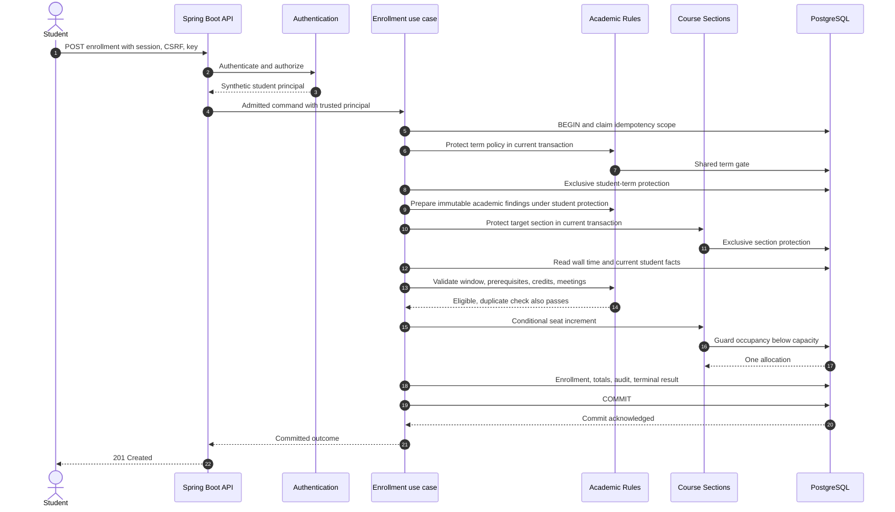
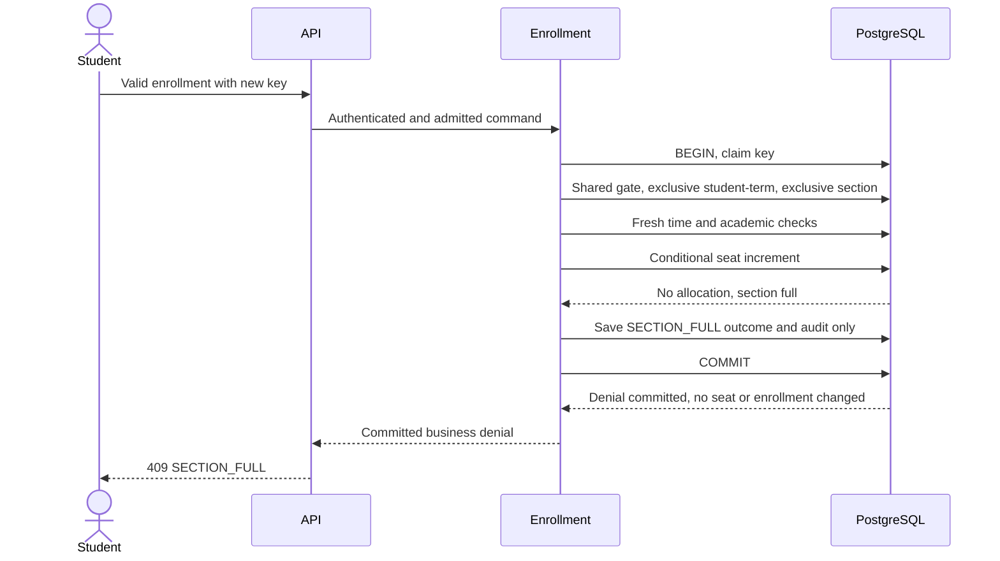
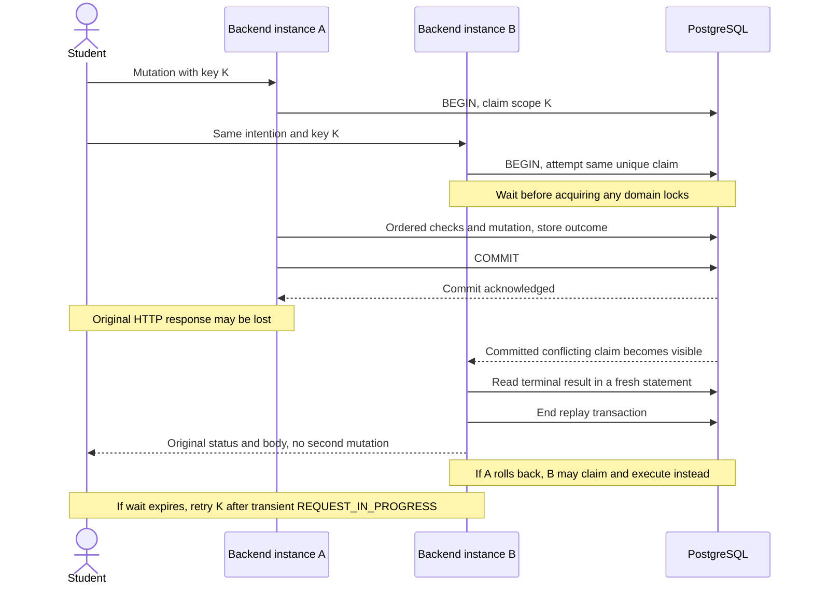

# Enrollment, transactions, and idempotency

Status: Phase 5 core write/read implementation and executed verification, November 6, 2026. AD-13 is adopted; [Phase 5 verification](phase5-verification.md) records transaction proxies, rollback, replay, concurrent cases and the bounded 2,000-student fixture. FR/NFR/BR/CT/PERF identifiers retain their original meanings.

This document owns the write protocol. [Architecture](architecture.md) owns module boundaries, [Scaling](scaling-strategy.md) owns admission/resources and operational failures, [Security](security.md) owns identity, and [Requirements](requirements.md) owns acceptance rules. Phase 3 physical details now belong to [Database](database.md) and [Database concurrency](database-concurrency.md). The Phase 5 runtime implements the refined protocol. Phase 3 selects UUID client keys, a shared technical operations adapter, no stored student credit counter, expanded dated meetings and standard JDBC session tables.

## Invariants and assumptions

- BR-01: active section membership never exceeds capacity, and occupancy never becomes negative.
- BR-02: at most one active enrollment per student/section. The additional one-active-section-per-offering rule remains provisional under Q-03.
- BR-03/BR-04: concurrent operations cannot jointly exceed a student's credit limit or create overlapping required meetings.
- BR-05/BR-10: decisions use immutable published course/meeting/prerequisite versions and local frozen eligibility evidence. New evidence does not alter an in-flight decision.
- BR-06/BR-07/BR-09: membership, seat accounting, any maintained credits, audit, and terminal replay result commit together; withdrawal releases once.

Every writer must use this protocol, including a later background import or administrative correction. The runtime database role is not a human correction interface. A stable student-term coordination record and stable term-policy gate exist before opening; missing records yield an explicit unavailable/configuration failure, never an unlocked fallback.

The **term-policy gate** refines Phase 1's window lock: it is the stable logical coordination resource for all cohort windows and policy selection in one term. Protecting it covers creation/reselection of windows, not just updates to a previously selected row. Phase 3 represents it as `rules.term_policy_gates(term_id)`. Published window definitions/policy references are versioned; shared gate protection pins the selection until commit. Different terms have separate gates.

## Concurrency control comparison

| Approach | What it protects | Advantage | Limitation / decision |
| --- | --- | --- | --- |
| Atomic conditional UPDATE | Changes a seat counter only while its capacity predicate holds; affected-row outcome is checked | Compact final capacity guard; no stale application read decides success | Still has write contention; cannot alone protect credits/timetable across different sections. Retained as the allocation guard. |
| SELECT FOR UPDATE | Exclusive protection of named rows through the transaction | Explicit coordination and deterministic validation after waiting | A missing row is not protected; hot rows serialize. Selected for stable student-term and target-section resources. |
| Optimistic locking | Version/precondition rejects a write based on stale state | Useful for lower-contention administrative draft edits | Hot-section version conflicts can cause retry amplification; one section version does not protect another section's student totals. Not the primary enrollment protocol. |
| Pessimistic locking | Coordinates writers before reading/changing shared state | Makes student-wide checks and withdrawal accounting easier to reason about | Requires short transactions, ordered acquisition and finite waiting. Selected policy; SELECT FOR UPDATE is one implementation mechanism, not a competing category. |

**Primary choice: ordered PostgreSQL pessimistic coordination plus a conditional seat update and database uniqueness.** Explicit section locking is deliberately retained from Phase 1, even though the later UPDATE also locks the row. It establishes the common validation/time-sampling order for enrollment, withdrawal and capacity edits. A conditional-update-only section path is a possible measured optimization, requiring a new protocol review; it is not a second interchangeable MVP path. PostgreSQL describes row-lock modes in [Explicit Locking](https://www.postgresql.org/docs/current/explicit-locking.html).

## Transaction ownership and isolation

Authentication, CSRF checks, request-shape validation and admission happen before the enrollment transaction. A nonlocking locator read may discover a section's immutable term/offering or an enrollment's immutable owner/target; this is only a routing hint. A missing locator must not bypass an otherwise authorized matching terminal replay. Re-read and verify a new mutation's target after locks, and never trust a client-supplied student/term mapping.

The Enrollment application use case owns one short PostgreSQL **READ COMMITTED** transaction. Academic Rules and Course Sections transactional ports join that same connection/transaction; the local audit adapter joins it too. They cannot independently commit, start a new connection, or publish a success before the root commits. A future Spring implementation must enforce this through actual transaction interception and mandatory participation, not only method naming. Retries wrap fresh root transactions. Independent `REQUIRES_NEW` work is forbidden on this domain path; Spring distinguishes shared REQUIRED and independent REQUIRES_NEW transactions in [Transaction Propagation](https://docs.spring.io/spring-framework/reference/data-access/transaction/declarative/tx-propagation.html).

READ COMMITTED alone is insufficient. Student enrollment/schedule reads happen after obtaining student-term protection. Only compliant writers can change that student's membership; immutable published facts remove concurrent academic-data changes from the decision. Read statements then see completed preceding mutations rather than a snapshot captured before waiting. The conditional counter guard and uniqueness provide additional backstops. This reasoning depends on the complete writer inventory; it is not a proof for arbitrary SQL writers. See [PostgreSQL Transaction Isolation](https://www.postgresql.org/docs/current/transaction-iso.html).

No remote calls, real university authentication, network logging acknowledgement, or response rendering occur while domain locks are held. Business audit append uses the same database. A missing audit/result write rolls back the mutation.

| ACID property | Required design behavior |
| --- | --- |
| Atomicity | Membership, seat/credit effects, audit and terminal replay result either all commit or all roll back. A denial commits no academic mutation. |
| Consistency | Database constraints and the complete writer protocol preserve BR-01 through BR-09; account for membership/counter agreement, not only a bounded counter. |
| Isolation | READ COMMITTED writes are coordinated by the shared gate and exclusive student/section resources; immutable academic facts prevent unprotected live-policy changes. |
| Durability | Acknowledged success depends on PostgreSQL durable commit and retained replay/audit data. Do not disable WAL/durable commit protections to meet latency targets. Storage loss and restore guarantees still require the separately defined backup/RPO/RTO policy. |

## Global acquisition order and writer inventory

Acquire only needed resources, always in this order; skip unused levels and never acquire an earlier level later:

1. **Idempotency scope claim**, before any domain resource. Same-key conflicts resolve here.
2. **Term-policy gate**: shared row protection for enrollment, withdrawal and capacity edits; exclusive for window/configuration publication or close. Never upgrade a shared gate lock inside a transaction.
3. **Student-term coordination rows**, exclusive, sorted by stable student/term identifier if a future reviewed operation needs more than one. The MVP enrollment/withdrawal touches one.
4. **Section rows**, exclusive, sorted by stable section identifier; revalidate target/term mapping.
5. **Enrollment state, maintained totals and append-only audit/result writes**. Known enrollment rows are accessed for mutation only after their student's coordination resource and section are protected.

| Writer | Resources and permitted behavior |
| --- | --- |
| Enroll | Claim → shared term gate → exclusive student-term → exclusive section → membership/counters/audit/result |
| Withdraw | Same order; discover the enrollment target without locking, then verify ownership/target/state under protection |
| Admin capacity edit | Admin deduplication/precondition → shared term gate → exclusive section → validated capacity/audit; never reads a student's locked row afterward |
| Admin window close/configuration | Admin deduplication/precondition → exclusive term gate → policy/audit. No student/section locks needed for close itself. |
| Publication or academic import | Separate guarded workflow while the term gate is exclusive; cannot mutate a published academic version referenced by active enrollment. Create future versions or request a separate revalidation design. |
| Student-term provisioning | Before opening, Administration calls Enrollment's guarded PrepareStudentTerm API under exclusive term-gate protection; Student Management does not write Enrollment data. It cannot run as an unprotected insert-on-miss enrollment shortcut. |
| Idempotency cleanup | Operates only on expired terminal idempotency rows, with bounded batches and row protection; never acquires domain locks or deletes a claimed uncommitted operation |
| Reconciliation | Read-only consistent snapshot for detection. Repair is not an online MVP writer. |

Admin command deduplication and version-precondition storage need Phase 3 specification before admin implementation; they must stay at the first level and cannot introduce an inverted lock path. Ordinary foreign-key checks and unique-index interactions also belong in the physical writer inventory. Declaring this order reduces deadlocks; it does not establish that none can occur.

## Critical enrollment flow

1. **Authenticate** a synthetic MVP identity, verify student role/ownership and CSRF, validate bounds/key format, and apply admission limits. Reject before acquiring a connection if admission fails.
2. Begin the transaction and **claim the idempotency scope**. A committed matching terminal response replays after current authorization; a mismatch returns `IDEMPOTENCY_KEY_REUSED`. Neither branch acquires domain locks.
3. Acquire the **shared term-policy gate**, **exclusive student-term row**, then **exclusive target section**. All must exist. Resolve effective cohort/window and immutable academic versions under the gate; verify section publication and target identity.
4. **Validate the registration window** using actual database wall time after the waits. Apply `[opens_at, closes_at)` to the relevant cohort/operation. Do not use transaction-start `now()` as a substitute after a long wait: PostgreSQL distinguishes transaction time from `clock_timestamp()` in [Date/Time Functions](https://www.postgresql.org/docs/current/functions-datetime.html). Record this decision time.
5. **Validate academic rules** using locally stored authoritative eligibility evidence and immutable prerequisite definitions. Missing evidence is unavailable, not a passed prerequisite.
6. **Verify the credit limit** against current active enrollments after the student lock. Include the candidate course's published credits once. If a total is materialized, it must match the ledger and update atomically.
7. **Verify schedule conflicts** against every required occurrence of the student's current active memberships. Use the frozen academic timezone/date/recurrence model and half-open intervals; no Student Schedule HTTP call or foreign repository access is used.
8. **Verify duplicate enrollment** for section and provisional offering identity. Collecting validation findings permits an existing active enrollment to return `ALREADY_ENROLLED` rather than a misleading self-overlap/credit error; duplicate denial has precedence among these academic checks. All checks complete before mutation.
9. **Atomically allocate the seat** with a bounded conditional occupancy increment. Zero affected rows means `SECTION_FULL` after an authoritative capacity check; a database timeout is a technical failure. This is an uncommitted allocation, not a durable reservation or an expiring seat hold.
10. **Create the active enrollment**, apply any maintained credit change, append the audit event, and save the minimal terminal replay response. Database uniqueness must still hold. Unexpected violations roll back every domain change.
11. **Commit** the root transaction. If commit is acknowledged, release the response to the HTTP layer. An uncertain acknowledgement is resolved with same-key replay, never a new mutation key or a presumed rollback.
12. **Respond** with `201 Created` for a committed new enrollment, or a typed committed business denial. Response field `decidedAt` records the protected decision time; it is not the exact database commit timestamp. No HTTP success is emitted before commit.

A completed denial before any domain mutation may commit audit and a terminal idempotency result only. It is an explicit outcome, not an exception that silently marks the transaction rollback-only. After a seat/enrollment write or any database error, abort the whole transaction before mapping/retrying; never catch an error and commit a partial seat change. A response-serialization failure after commit is another lost-response case.

## Window close, withdrawal, and concurrent students

Requests for **one student/term**, even with different keys and different sections, wait on the same coordination record. The next transaction reads the resulting active memberships after acquiring it. This prevents combined credit excess, combined timetable conflicts, and double withdrawal. Distinct students normally proceed independently until they target the same section; there they serialize on section protection. No JVM-local mutex or Redis lock participates.

Withdrawal uses the same ordered protocol, but checks its separate permitted window. After protection, transition an active enrollment to withdrawn, decrement occupancy once and update any maintained credit total. Commit with audit/replay result. A previously withdrawn record returns its existing state without another release, subject to current authorization; a new active withdrawal decision must pass its window. A fresh enrollment may consume the released seat only after that withdrawal commits. A pre-commit rollback releases no seat. A new enrollment after withdrawal is a new intention/key and rechecks every academic rule.

Enrollment and withdrawal windows can differ, but both use the same term gate and student resource. A window-close command holds the term gate exclusively: it waits for current shared holders, commits closed policy state, then later decisions see closed state. Natural clock closing may occur between validation and commit; BR-11 allows a valid pre-deadline decision to commit afterward. No API-arrival-time or FIFO fairness is promised. Bound admission and every holder's lifetime; the close command also has its own deadline. If it cannot acquire protection within that budget, it fails retryably without claiming that registration has closed; no starvation-free close latency is assumed.

Closing a window does **not** make it safe to alter meetings/credits already referenced by active students. The baseline leaves referenced published versions immutable even when closed; a correction affecting existing memberships needs an explicitly reviewed revalidation/recovery workflow.

## Idempotency key lifecycle

| State / event | Decision |
| --- | --- |
| New intention | Client generates a high-entropy opaque key before the first mutation attempt and retains it until the outcome is resolved; POST and DELETE have separate operation scopes. |
| Scope and fingerprint | Unique scope is authenticated internal principal + versioned operation + key. Canonical fingerprint includes method/operation version, target and normalized body; exclude correlation ID, cookies and changing transport metadata. Key length/encoding bounds are configuration TODOs. |
| Claim | Claim scope in PostgreSQL in the root transaction before domain locks. Internal processing state is **uncommitted**; there is no separately committed long-lived IN_PROGRESS reservation or lease to steal. |
| Concurrent identical request | Unique-scope conflict waits within its own remaining deadline. If the winner commits, read/replay its terminal result in a fresh visible statement; if it rolls back, the contender can claim and run. Wait expiry returns transient `409 REQUEST_IN_PROGRESS` with retry guidance, not a stored terminal denial. |
| Payload mismatch | Once the claimed winner's fingerprint is visible, a mismatch returns `409 IDEMPOTENCY_KEY_REUSED`; do not disclose or overwrite the other response. |
| Successful mutation | Store stable status/minimal response, target identity and decision time with enrollment/audit, then commit. Replays return the historical operation result, not a current schedule assertion. |
| Stable business denial | Store a terminal denial and audit with no academic mutation. A later replay stays denied even if a seat becomes available; reconsideration requires a deliberate new intention/key. |
| Transient failure | Roll back the claim and domain effects. Do not store pool exhaustion, deadlock, outage, timeout, audit failure, or REQUEST_IN_PROGRESS as terminal academic decisions. |
| Before-commit process crash | Database connection cleanup/transaction timeout aborts the uncommitted claim and domain changes. No application sweeper treats uncommitted work as completed or steals it based on elapsed time. |
| After-commit process crash | Terminal outcome already exists with domain state; any replica can authenticate and replay it. |
| Retention and expiry | Keep terminal keys for a configured supported recovery horizon, agreed before implementation. Cleanup only after expiry and protects the row against concurrent claim/replay; an expiry-boundary retry must have a defined winner. Keys after expiry have no replay guarantee; active uniqueness still prevents simultaneous duplicates, but cannot prevent a new enrollment after withdrawal. |
| Long absence / lost key | Read authoritative own enrollments and schedule and reconcile intent before making a new request. Do not silently auto-submit a new key, especially after retention expiry. |

Phase 3 specifies the [claim/replay/expiry-boundary mechanics](database-concurrency.md#idempotency-claim-replay-and-expiry-algorithm): expired scope reuse deletes the old operation UUID under protection and creates a new one. Phase 5 selects an isolated MVP retention of 24 hours from protected decision time, with a conservative supported client recovery horizon of 23 hours from the original submission. Q-11 remains open for a shared deployment. Idempotency does not promise exactly-once delivery. It provides one committed effect per supported scoped intention during retention, backed independently by active membership uniqueness.

## Rollback, retries, and crash points

Database uniqueness is required for non-null active student/section keys, provisional active student/offering keys, the student-term coordination identity, and idempotency scope. Phase 3 chooses retained enrollment episodes with two active-only unique indexes and ordinary composite FK targets, ensuring a section's offering/term references cannot disagree with enrollment references. [Data integrity](data-integrity.md) distinguishes row constraints from aggregate/academic protocol obligations. A repeated business operation with different keys is rejected by domain checks plus uniqueness; idempotency alone is insufficient.

| Event | Transaction/result behavior | Retry behavior |
| --- | --- | --- |
| Crash before begin / before claim | No domain effect | Retry same key after recovering authentication |
| Crash after claim or seat change, before commit | All uncommitted state aborts when PostgreSQL detects disconnect/timeout; locks can remain until then | Same-key contender waits within bounds; no duplicate effect |
| Audit/result write failure | Root transaction rolls back membership, counters and claim | Technical failure; retry same key |
| Deadlock (`40P01`) or genuine serialization failure (`40001`) | Abort entire transaction; never continue in aborted state | Retry fresh root transaction with same key, bounded jitter and total deadline |
| Lock/statement/pool wait expires | Roll back any begun transaction; no fabricated academic denial | Bounded client retry with same key; do not spin automatically on repeated saturation |
| Unique violation after attempted domain writes | Roll back seat/credits/membership/result together; inspect named conflict using a fresh transaction | Only a recognized duplicate can be re-evaluated/mapped; unknown constraints are technical failures, not success |
| Commit acknowledged, then crash / network loss | Mutation and replay result remain committed | Replay same key; do not compensate based only on client disconnect |
| Commit acknowledgement lost | Outcome unknown to caller; it may already be committed | Recover PostgreSQL, authenticate and replay same key to discover the result; never blindly retry with a new key |

Retries live outside the transaction interceptor so each attempt has fresh state, timeout budget and connection acquisition. Cap attempts and elapsed time; no retry of stable business denials or fingerprint mismatches. Exact caps and deadline allocations require measurement. HTTP disconnect alone is not proof of database cancellation; cancellation must roll back before commit if possible, otherwise replay resolves the committed result.

## Successful registration sequence

Student Management and Course Catalog facts are fetched through their public immutable snapshot interfaces within this transaction; their messages are omitted here to keep lock/commit order visible. All DB arrows share one root transaction, not independent module commits.

## No seats sequence

## Concurrent identical requests and replay sequence

## Contention fixture and proof obligations

For CT-01, 2,000 distinct eligible students contend for an initially empty 30-seat section, with no withdrawal/admin changes and an open window. Under the protocol, each committing allocator holds section protection and can increase occupancy only below capacity; a rollback contributes no membership or increment. Database uniqueness independently prohibits duplicate active membership. Thus the design intends at most 30 committed active members, not 2,000 successful enrollments.

In a healthy fixture where all attempts finish with adequate deadlines, expect exactly 30 distinct successes and 1,970 `SECTION_FULL` outcomes. Pool/lock timeouts may reduce completed allocations or yield technical failures; those fail that complete-allocation run even if safety holds. Concurrent withdrawals permit more than 30 historical successes over time while active membership still stays within capacity; the no-withdrawal fixture must not be confused with that workload.

CT-02/CT-03/CT-04 must exercise different keys and different backend instances, not just repeated calls on one thread. CT-05/CT-06 inject crashes on both sides of commit; CT-07 races withdrawal and enrollment; CT-08/CT-09 cover admin operations; CT-10 tests timeouts/deadlocks/dependency failure. Verify database invariants and accounting independently of response counts. Phase 4 executed selected database primitives. Phase 5 subsequently executed the core service/HTTP acceptance cases and controlled 2,000-student allocation. Forced OS-process crashes, TCP commit-ack loss and large HTTP load remain outside that evidence; see [Phase 5 verification](phase5-verification.md).
